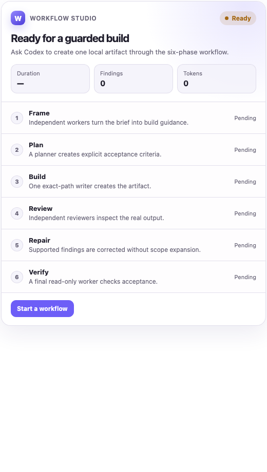

# Workflow Studio for Codex

[](https://github.com/alexanderradahl/workflow-studio/actions/workflows/ci.yml)
[](LICENSE)
[](https://github.com/alexanderradahl/workflow-studio/releases)

Turn a substantial coding request into a scoped plan, implementation, independent review, repair, and verified result—inside Codex, with an inline dashboard.

Workflow Studio is an open-source Codex plugin built on [Ultracode](https://github.com/just-every/plugin-ultracode). It brings a Claude-style workflow to Codex while keeping repository writes bounded and acceptance tied to observed file changes.



*Illustrative dashboard. Actual timing and token usage depend on the task.*

## Install

Requirements: **macOS**, **Node.js 24+**, **Git**, an authenticated **Codex** installation with custom filesystem permission profiles, and **Ultracode**. Other operating systems have not been validated; the worker wrapper uses macOS tooling and zsh.

Install the engine and this plugin:

```bash
codex plugin marketplace add just-every/plugins
codex plugin add ultracode@just-every
codex plugin marketplace add alexanderradahl/workflow-studio
codex plugin add workflow-studio@workflow-studio
```

Start a **new Codex chat** so the skill and MCP server load. Node must be available to the Codex app. No private shell helper, additional API key, or repository-local npm installation is needed to run the installed plugin. Workers use your existing Codex authentication and consume your account's model usage.

The runtime discovers Codex on `PATH` or in the supported macOS app locations, and Ultracode in its installed `just-every` plugin cache. It does not install or update these dependencies automatically.

## Try it

```text
$workflow-studio Implement pagination across src/search and tests/search.
$workflow-studio Create a launch brief at docs/launch-brief.md.
Show the latest Workflow Studio dashboard.
```

Describe the outcome, constraints, and relevant checks. Codex inspects the repository and establishes the exact write scopes before execution. Prepare the target repository's dependencies first; workflow workers have command networking disabled.

| Use it for | Use ordinary Codex for |
| --- | --- |
| A substantial single-file artifact or multi-file repository change | Small edits, direct answers, read-only analysis |
| Changes that benefit from separate planning and independent review | Command-only work, status checks, external actions |
| Bounded work in an existing Git worktree | Tasks where minimum latency or cost matters most |

## How it works

```text
Discover → Plan → Implement → Review → Repair → Verify
  parallel          one       parallel   one    read-only
  read-only         writer    read-only   writer
```

Single-file mode uses **Frame → Plan → Build → Review → Repair → Verify**. Repair runs only when reviewers find actionable issues. Workspace writers run sequentially so they do not race each other. Final acceptance checks the actual changed-file set against the writer and verifier reports.

| Tool | Purpose |
| --- | --- |
| `run_build_artifact` | Create and verify one exact local output file |
| `run_workspace_workflow` | Implement a bounded change in an existing Git worktree |
| `show_workflow_dashboard` | Inspect the latest trusted run |
| `get_workflow_run` | Inspect a specific trusted run ID |

The dashboard shows workflow phases, findings, authorized scopes, planned/changed/verified files, duration, and usage. Its Open output / Open changes actions hand the result back to Codex.

## Write boundaries and verification

- Workspace mode requires a canonical Git root with a valid `HEAD` and 1–32 normalized relative write scopes.
- Workspaces and their Git metadata must live outside shared `/tmp` and `/var/tmp` directories, where Codex grants shell write access independently of custom scopes.
- Root-wide access, `.git`, traversal, symbolic links, hard links in writable scopes, and unsafe missing parents are rejected.
- Workers preserve applicable repository instructions and pre-existing changes. They cannot commit, push, publish, deploy, send messages, or use command networking.
- Repository `AGENTS.md` instructions stay active. Inherited command-approval `.rules` files are disabled so unrestricted command grants cannot bypass worker scopes.
- Host snapshots detect changes in tracked, untracked, and ignored files. Ignored dependency trees use aggregate content hashes and bounded parallel hashing to keep inventories compact. Changes outside the authorized scopes prevent acceptance.
- Report schemas require repository-relative paths. The host independently checks the reported and observed file sets.
- `accepted: true` is the success condition. A failed run may leave partial changes; it does not imply rollback. Review the changed files before continuing.

The plugin exposes fixed task arguments; callers cannot pass arbitrary workflow scripts, binaries, flags, environment variables, or network overrides. See [SECURITY.md](SECURITY.md) for reporting and limitations.

## Troubleshooting

| Symptom | Next step |
| --- | --- |
| Missing Codex or Ultracode | Follow the dependency named in the error, then start a new chat |
| Required tests cannot find dependencies | Prepare dependencies in the target worktree before starting the workflow |
| A test runner needs temporary files outside the write scope | Use a disposable validation copy under `TMPDIR`; keep source writes scoped |
| Workspace is in shared system temporary storage | Use a project directory such as `~/Projects`, including the linked worktree’s main repository |
| A run fails after some edits | Inspect its actual worker error and changed-file evidence before continuing |
| Tools still behave like an older release | Reinstall the plugin and start a new Codex chat |
| The host rejects a writable tool before launch | Resolve the host's approval policy; a tool rejection is not a workflow execution |

Version 0.2.1 repairs the planner path-format failures, obscured errors, and snapshot bottleneck found in real workspace runs. See the [changelog](CHANGELOG.md) for details.

## Reliable selection in crowded Codex profiles

Explicit `$workflow-studio` invocation is the portable baseline. Codex can also select the skill implicitly for eligible work. To make routing more reliable in profiles with many skills, optionally add this bounded rule to `~/.codex/AGENTS.md`:

```markdown
Use $workflow-studio for an explicit substantial single-file artifact or multi-file repository change when separate discovery, planning, implementation, review, repair, and verification materially improve the result. Require a concrete brief, a destination, and bounded write scopes. Keep direct answers, trivial edits, read-only work, command-only tasks, and external actions on their ordinary Codex path. Invocation alone does not authorize a write.
```

The plugin does not edit global Codex instructions during installation.

## Develop and contribute

```bash
git clone https://github.com/alexanderradahl/workflow-studio.git
cd workflow-studio
npm ci
npm run check
```

The test suite runs without model calls or Codex credentials. It covers workflow execution with controlled worker reports, runtime acceptance evidence, path guards, workspace snapshots, worker arguments, MCP stdio, discovery, and packaging. Live model verification is separate and uses account usage.

The inline widget is bundled into `dist/workflow-studio-widget.html`; the installed server uses Node's built-in modules. Run `npm run build` after changing widget sources and commit the generated file. CI checks that the bundle is current.

Start with [CONTRIBUTING.md](CONTRIBUTING.md), [release guidance](RELEASING.md), and the [issues](https://github.com/alexanderradahl/workflow-studio/issues).

## License and attribution

[MIT](LICENSE), copyright Alexander Benz. Workflow Studio uses the MIT-licensed Ultracode engine as a separately installed dependency and bundles the MCP Apps client with its [license notices](THIRD_PARTY_NOTICES.md). This is an independent project; it is not an official OpenAI or Anthropic product.
